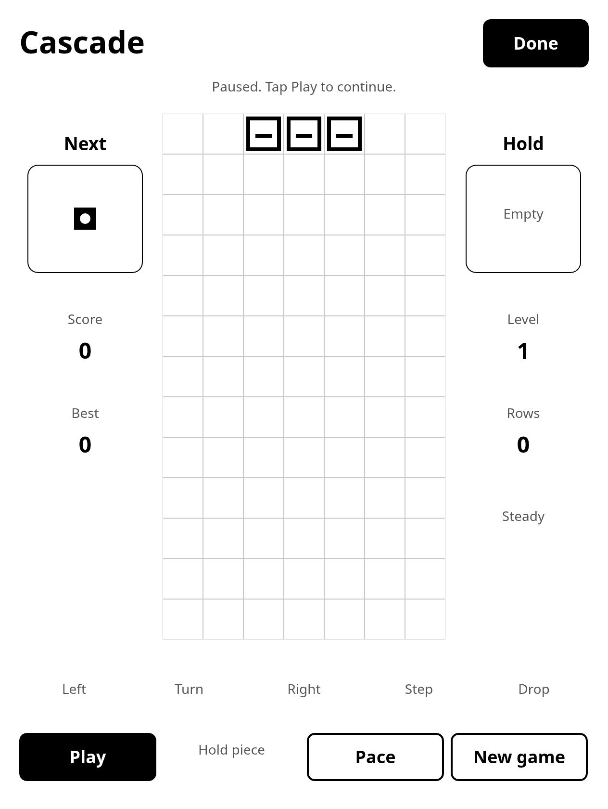

<div align="center">

# Cascade

**A falling-piece game for e-ink**

[](https://github.com/PrimitiveOS/kindle-primitive-cascade/releases) [](LICENSE) [](https://primitiveos.github.io/kindle-primitive-catalog/v1/index.json)

[**Download**](https://github.com/PrimitiveOS/kindle-primitive-cascade/releases/latest) · [**Install guide**](INSTALL.md) · [**Changelog**](CHANGELOG.md)

</div>

---

Guide original falling shapes on a narrow board, clear rows and beat your score. Play with the page buttons or touch, and choose from three paces.

## Quick start

After setting up PrimitiveOS, open **Store** from Primitive Launcher. Choose **Cascade** under **Apps**,
tap **Get**, and open it from the Launcher grid. The [install guide](INSTALL.md) also covers the standalone USB package.

## Screenshots

<table>
<tr>
<td align="center"><br><sub>Resume a paused board</sub></td>
<td align="center"><br><sub>Play in dark mode</sub></td>
<td align="center"><br><sub>Choose a falling pace</sub></td>
</tr>
</table>

<sub>Mac simulation captures at 1264 × 1680 pixels.</sub>

## Highlights

- **Control each fall.** Use **Turn** to rotate, **Step** to descend one row, or **Drop** to place the piece immediately.
- **Plan ahead.** Save one piece with **Hold piece** and preview the next shape beside the board.
- **Pause and resume.** Choose one of three provisional paces. Cascade remembers your best score and pauses when the Kindle sleeps. Choose **Play** after wake to resume.

## Develop locally

Keep `doannt-kindle-tools` and `doannt-kindle-launcher` beside this checkout, then run the following from this repo.

```sh
cargo test --offline --locked --workspace
cargo run --offline --locked -p cascade-desktop
```

The desktop target writes previews to `build/previews/`. The desktop simulation exercises falling steps, touch controls, and sleep.
On an ARMHF Kindle Oasis 3 running firmware 5.18.2, Cascade opened and closed the pace picker, preserved the
paused board and selected pace, and returned to Launcher. The release name, pace, and physical Kindle timing and
ghosting checks are pending. See the [device notes](docs/device-notes.md) for the verification checklist.

## Status

| Device | Status |
|---|---|
| Kindle Oasis 3 (1264 × 1680, firmware 5.18.2) | Tested on hardware |

**Current version: 0.1.1.** Changes are in [CHANGELOG.md](CHANGELOG.md).

## Downloads

The badge at the top shows the number of Store downloads. It counts GitHub downloads of this app's release packages, across all versions and architectures, and is refreshed daily from the [Store catalog](https://primitiveos.github.io/kindle-primitive-catalog/v1/index.json).

## Documentation

[Install guide](INSTALL.md) · [Changelog](CHANGELOG.md) · [Device notes](docs/device-notes.md)

## Licence

Copyright (C) 2026 Doan Nguyen.

Code is licensed under [PolyForm Noncommercial 1.0.0](LICENSE). The original documentation and pictures are licensed under [CC BY-NC-SA 4.0](LICENSE-DOCS).
