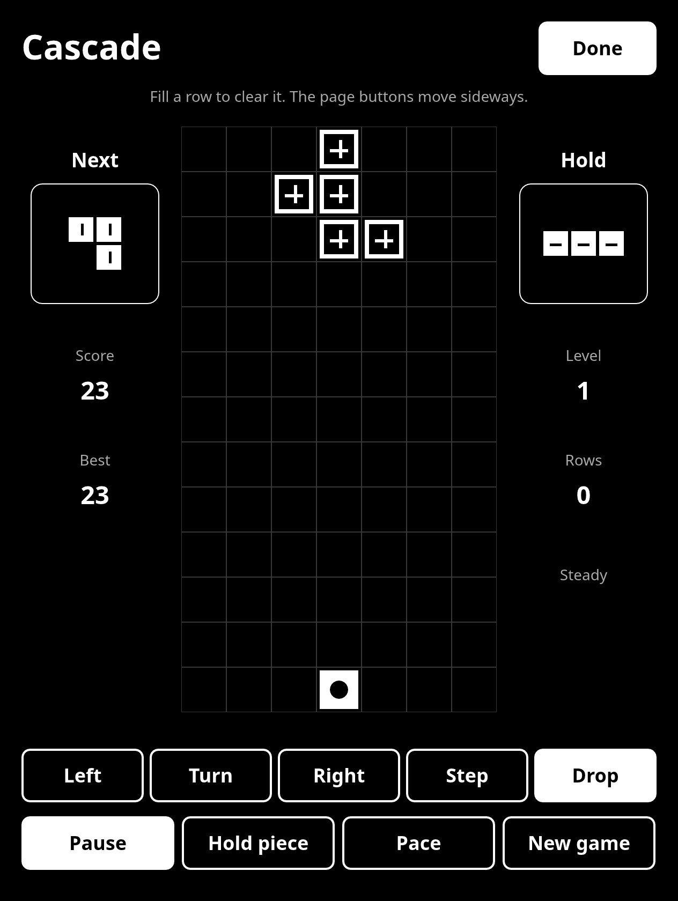
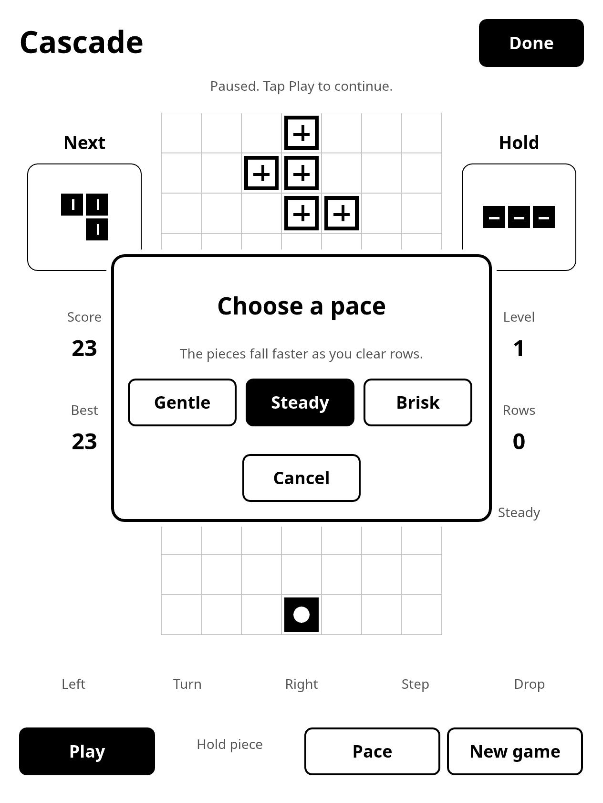

<div align="center">

# Cascade

**Clear rows in an original falling-piece game for e-ink.**

[**Install guide**](INSTALL.md) · [**Device notes**](docs/device-notes.md) · [**Changelog**](CHANGELOG.md)

</div>

---

Cascade is the working title for a game that fits six shapes into a seven-lane board. Clear rows to earn points and reach higher levels. Steer with the page buttons or touch controls.

## Screenshots

<table>
<tr>
<td align="center"><br><sub>Resume a paused board</sub></td>
<td align="center"><br><sub>Play in dark mode</sub></td>
<td align="center"><br><sub>Choose a falling pace</sub></td>
</tr>
</table>

<sub>Mac simulation captures at 1264 × 1680 pixels.</sub>

## Highlights

- **Control each fall.** Use **Turn** to rotate, **Step** to descend one row, or **Drop** to place the piece immediately.
- **Plan ahead.** Save one piece with **Hold piece** and preview the next shape beside the board.
- **Pause and resume.** Choose one of three provisional paces. Cascade remembers your best score and pauses when the Kindle sleeps. Choose **Play** after wake to resume.

## Quick start

1. Find the local ARMHF package and USB installation steps in the [install guide](INSTALL.md).
2. Extract the package, copy the `cascade` and `documents` folders to your jailbroken Kindle’s user storage, and eject it.
3. Open Cascade from Primitive Launcher. **Done** returns to the launcher grid.

## Develop locally

Keep `doannt-kindle-tools` and `doannt-kindle-launcher` beside this checkout, then run the following from this repo.

```sh
cargo test --offline --locked --workspace
cargo run --offline --locked -p cascade-desktop
```

The desktop target writes previews to `build/previews/`. The desktop simulation exercises falling steps, touch controls, and sleep. The release name, pace, and physical Kindle timing and ghosting checks are pending. See the [device notes](docs/device-notes.md) for the verification checklist.

## Licence

Copyright (C) 2026 Doan Nguyen.

Code is licensed under [PolyForm Noncommercial 1.0.0](LICENSE). The original documentation and pictures are licensed under [CC BY-NC-SA 4.0](LICENSE-DOCS).
